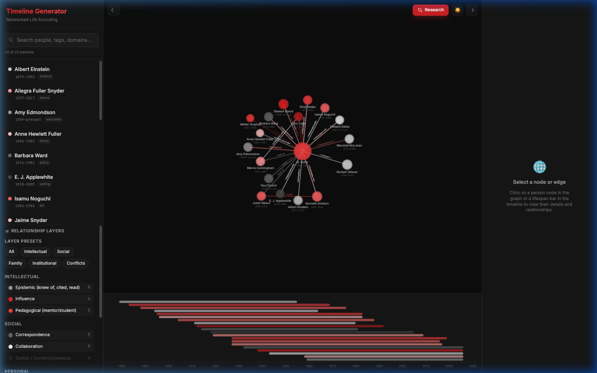
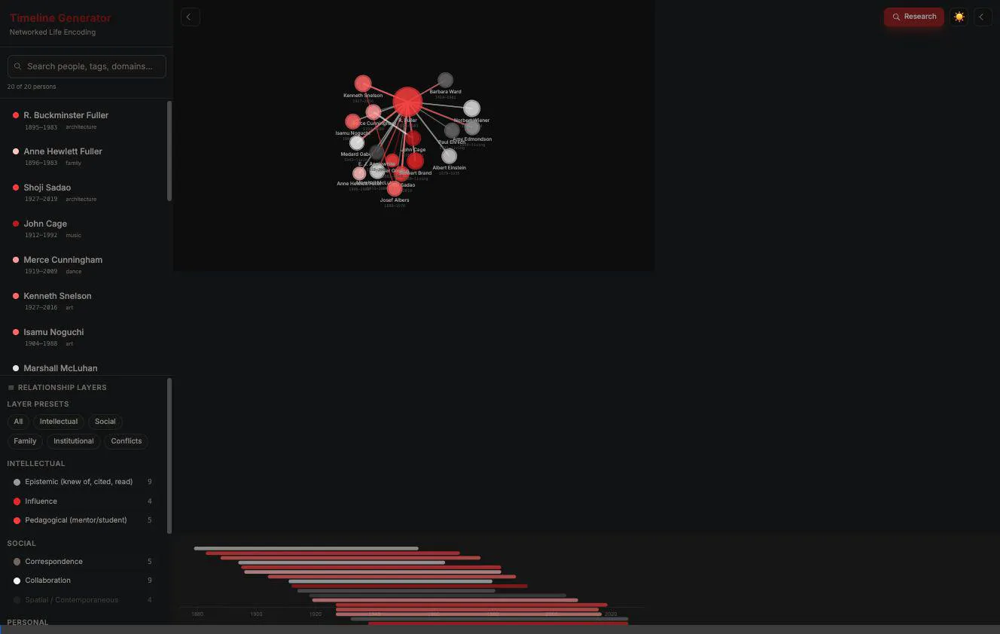
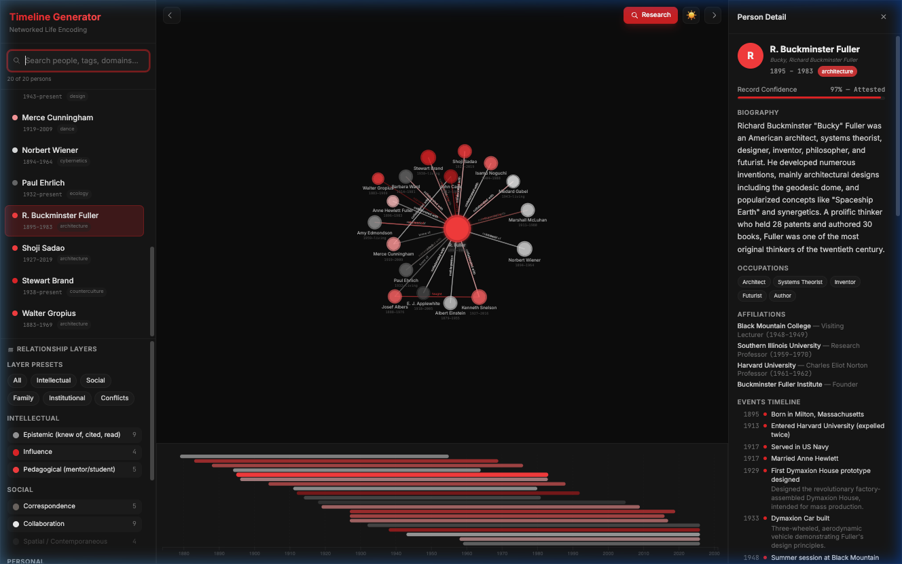
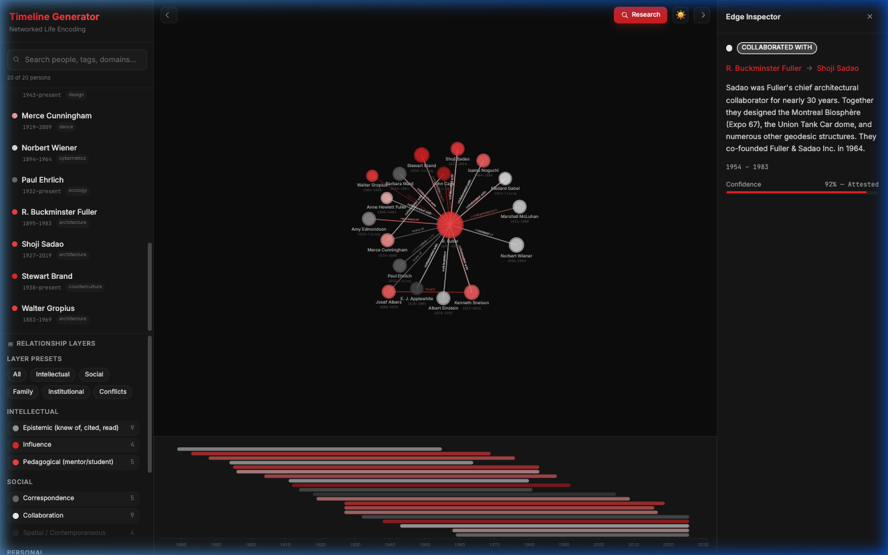
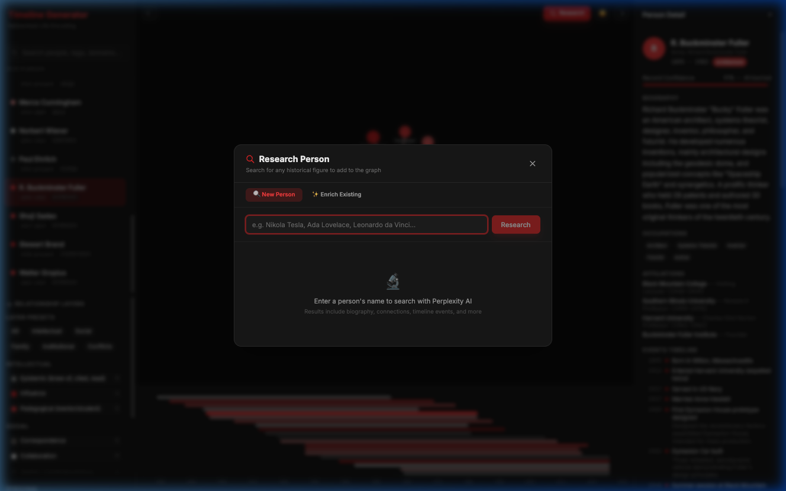
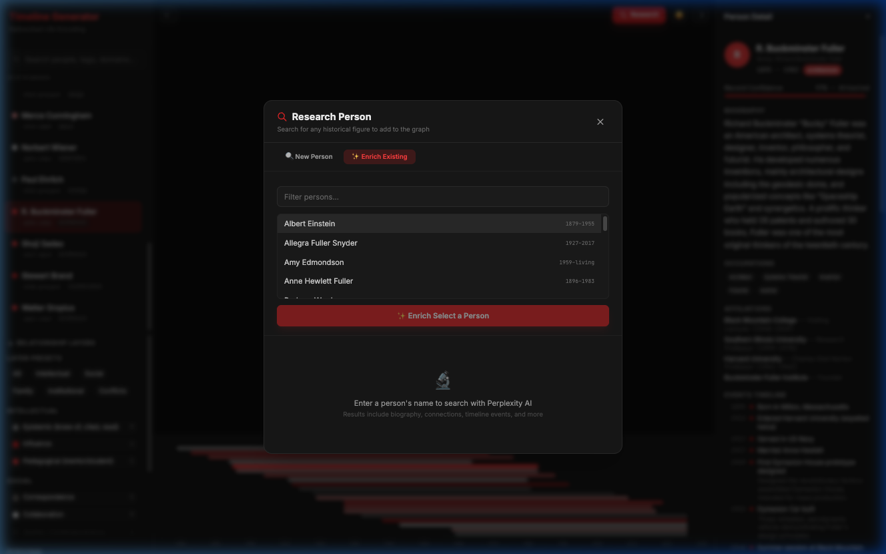
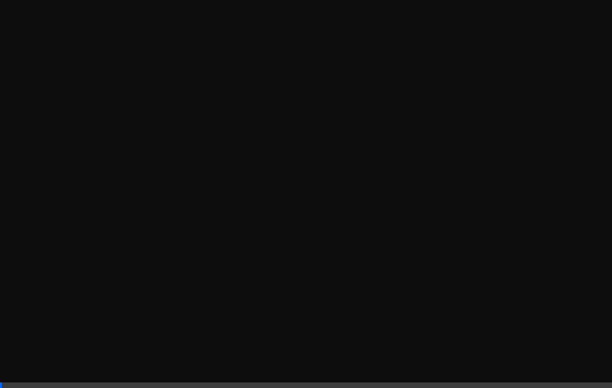

# Interface gallery

These captures show the included seed dataset and the application's original
research UI. See the [local walkthrough](getting-started.md#explore-the-graph)
for the current controls.

## Graph and timeline

## Person and relationship details

## Research dialog

